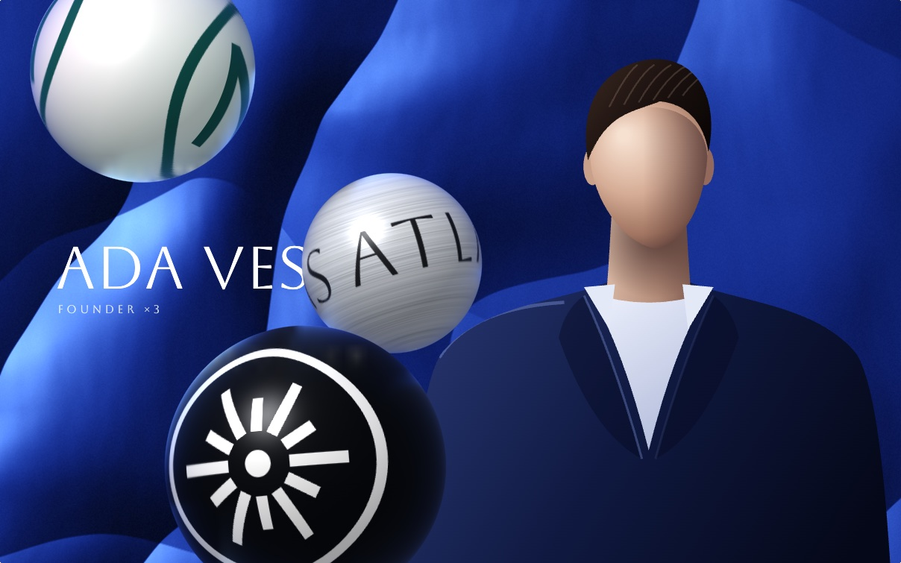
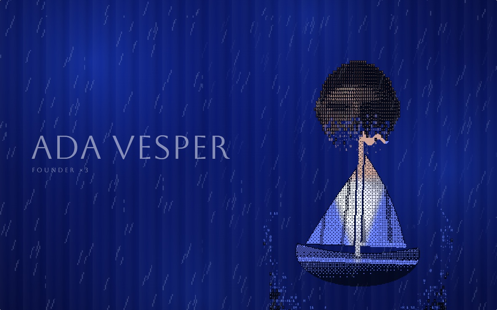
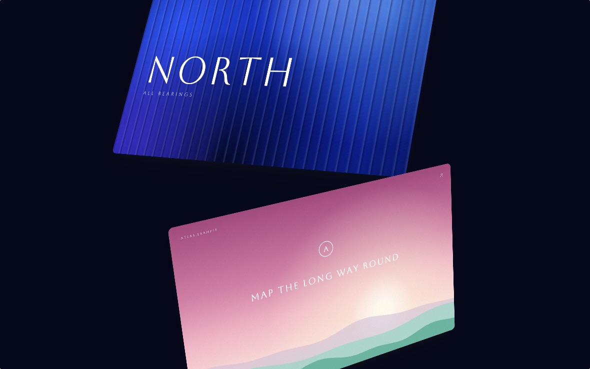
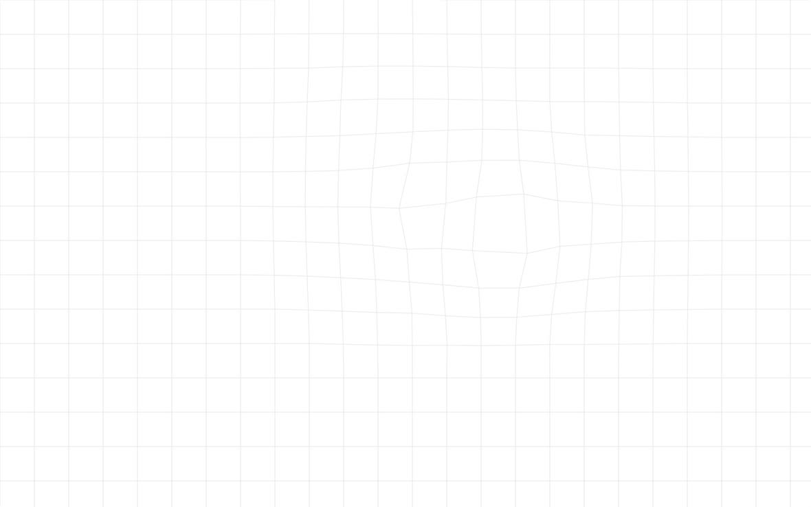

# motion-offcuts

Animations and a desktop hero from [jjmartin.co](https://jjmartin.co), free to reuse.

These are pieces JJ designed for his site and then cut, in October 2026: most from the home page, and the grid that sat behind the rest of it. Alongside them is the desktop hero he designed for the site. The animations are small modules in plain JavaScript, with a demo page that runs every piece of their group. The hero is a React component with a Next.js demo. The demos use stand-in pictures made in code, so there is nothing to download and nothing of the site's own imagery in them. Take what is useful.

## What is here

### [floating-marks](floating-marks/)

A few marks cross a hero picture while a figure stands in it. Spheres, coins, an orbit, a deck of plates and a quiet index.

[](floating-marks/)

### [figure-to-sprite](figure-to-sprite/)

A picture turns to type, and the type to a 1-bit sprite that plays on in the rain. Three ways across (erosion, rain, retype) and four palettes.

[](figure-to-sprite/)

### [card-transitions](card-transitions/)

Five ways to move between full-screen cards on one scroll. The helix is the one that shipped; calm, ribbon, crate and sheets are the options it was chosen from.

[](card-transitions/)

### [bulging-grid](bulging-grid/)

A hairline grid that bulges under the pointer and under three slow swells that drift and breathe. The background of the site's blog, press and contact pages.

[](bulging-grid/)

### [desktop-hero](desktop-hero/)

A React hero dressed as a desktop: a wallpaper under fluted glass, a cut-out figure, posts as files and a dock, and on a phone an iOS-style home screen.

[](desktop-hero/)

Each folder has its own README with the pieces, their options and where they came from.

## Run it

The animations have no build step and nothing to install. Any static server will do:

```
python3 -m http.server
```

Then open `http://localhost:8000/`. The demo pages need a server because they load ES modules.

Pages load Aboreto, Cormorant Garamond and EB Garamond from Google Fonts. Everything else is in the repo.

The desktop hero is the exception. It is a React component with a Next.js demo, so it needs Node and an install:

```
cd desktop-hero && npm install && npm run dev
```

Then open `http://localhost:3000/`.

## Use a piece in your own page

This is for the plain-JavaScript pieces. Each is a module that exports `sketches = { name: async (env) => sketch }`. `shared/runtime.js` mounts them, runs their frames only while they are on screen, and draws the controls:

```html
<link rel="stylesheet" href="shared/stage.css">
<div class="stage" data-sketch="./floating-marks/coins.js#coins"></div>
<script type="module" src="shared/runtime.js"></script>
```

What a factory gets, `env`:

- `stage`: the element to draw into.
- `canvas(type)`: a canvas filling the stage at the device's density, as `{ canvas, ctx, w, h, dpr }`.
- `img(src)`: a promise of an image.
- `settings`: the state of the page's toggles.
- `reduced`: whether the reader asked for reduced motion.

What it returns: a sketch with `render(u, time, dt)`, where `u` runs 0 to 1 over `duration` seconds (a loop), or for the scroll pieces `render(s)` with `s` the scroll in screens, plus an optional `resize(w, h)`.

To use one without the runtime, import the module, call `sketches.name(env)` with an `env` of your own, and call `render` from your own loop. The header of `shared/runtime.js` is the full contract.

The pictures the pieces draw over (the figure, the marks, the cards) are in each group's `placeholders.js`. Swap that file for your own and the pieces follow.

The desktop hero is used as a React component instead: copy `desktop-hero/src/hero/` into your project and see its [README](desktop-hero/README.md) for the props.

## Credits

The pieces are reworkings of ideas, not copies of anyone's code:

- 100k.studio's floating balls, for the spheres.
- Unveil's stacked records, for the deck, the crate and the helix's stations, and its filter bar, for the index.
- Simon Rogers' ribbon (loadmo.re), for the ribbon and the helix.
- Bureau Cool's orbit tile, for the orbit.
- The split-flap departure board, for the retype.
- YUDHO's "I will survive" inspired the idea of a sprite in the rain. None of its art is included.

The desktop hero uses [Paper Design's shaders](https://github.com/paper-design/shaders) (Apache-2.0) for its fluted glass, as a dependency. Its post icons port the shader's contour flute to a 2D canvas.

## Licence

MIT, see [LICENSE](LICENSE). It covers the whole repo, except the portrait, writing and company marks of jjmartin.co that show in the screenshots in `desktop-hero/docs/`.

By José (JJ) Martín Quesada, [@itsmartinwho](https://github.com/itsmartinwho).
