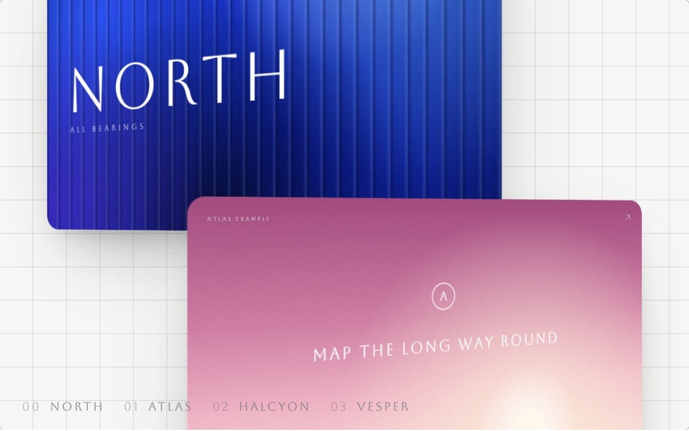
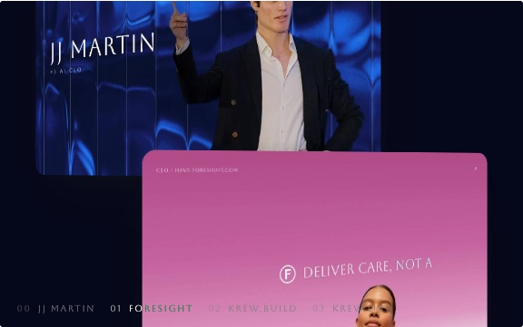
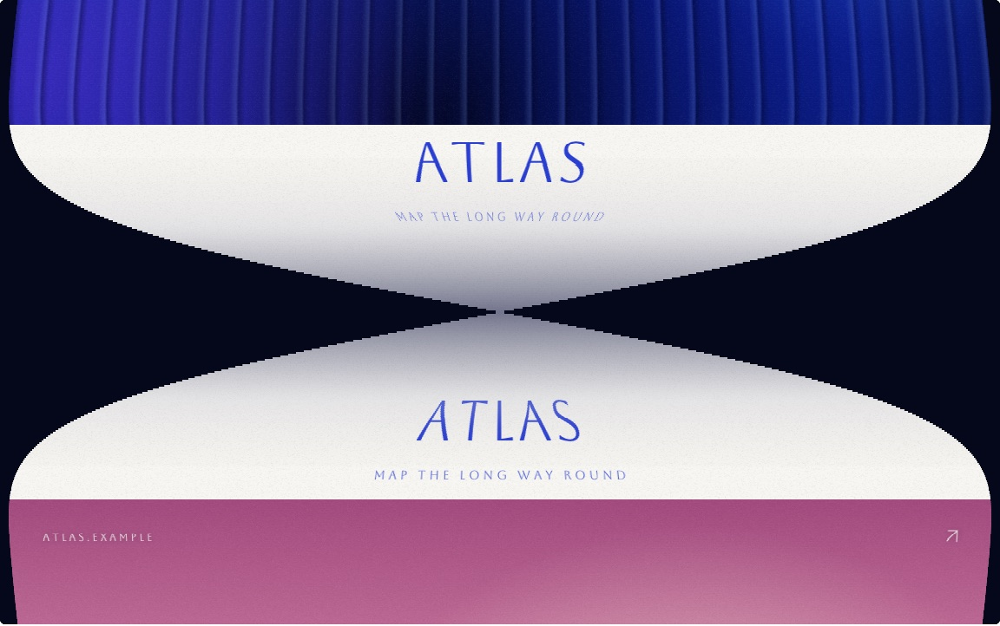
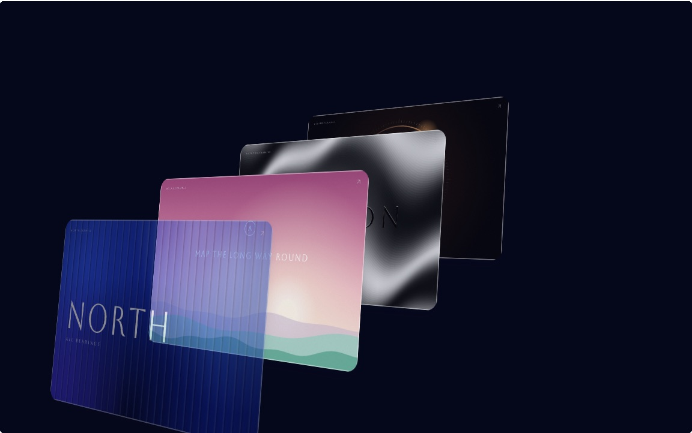
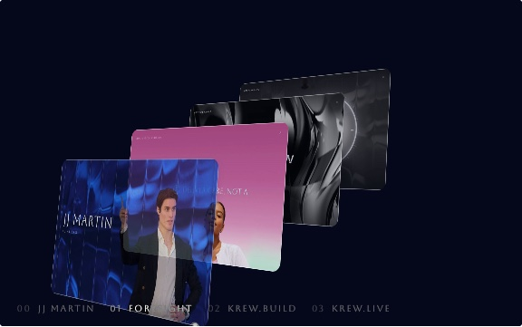
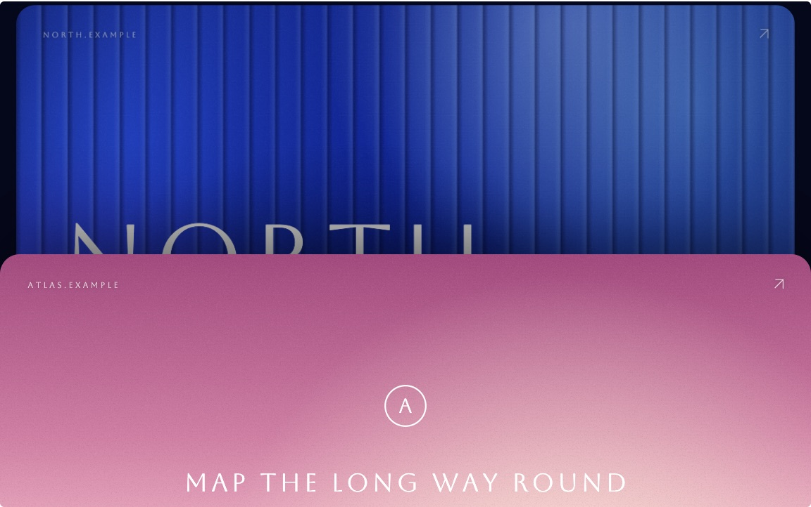

# card-transitions

Five ways to move between full-screen cards on one scroll, in plain JavaScript. No build step, no dependencies.

The cards here are stand-ins painted in code (NORTH, ATLAS, HALCYON, VESPER). In the pictures below, the right-hand ones show the same transitions on the cards of jjmartin.co.

Run it from the repo's root with `python3 -m http.server`, then open `/card-transitions/`. Scroll inside a frame, or press Play for a tour. The toggles on the page are the runtime's: Input (the camera eases toward the scroll, or follows it raw), Settle (after you stop mid-turn, ease on to the nearer card), Ground (ink, or a white page with a grid so the shadows show) and Index (the card names along the bottom).

## The pieces

### Helix (`helix.js`, `helix`)

The cards are strung on a spiral whose axis leans, like a corkscrew. The card the camera is on is square to the screen. Mid-turn the camera draws back, so three cards of the spiral show, their corners rounding and their shadows falling on the page. This is the one on the site's home page.

| Stand-ins | On jjmartin.co |
|---|---|
|  |  |

### Calm (`helix.js`, `calm`)

The same maths with the axis upright, a third of the pull-back, and a longer hold than turn. It is the quiet version.

| Stand-ins, on the white ground | On jjmartin.co |
|---|---|
|  |  |

### Ribbon (`ribbon.js`, `ribbon`)

The cards sit on one strip. Where two meet, the strip makes a half twist and for a moment you look at the seam, a paper face printed with the name of the next card. It is drawn row by row on a 2D canvas, each row at its own angle of twist: narrower as it turns edge-on, darker, with a faint sheen.

| Stand-ins | On jjmartin.co |
|---|---|
|  |  |

### Crate (`crate.js`, `crate`)

The cards as records in a diagonal crate. Each move has three beats that overlap: the card on screen settles into the stack, the stack slides one place, the next record lifts out and grows to fill the screen.

| Stand-ins | On jjmartin.co |
|---|---|
|  |  |

### Sheets (`sheets.js`, `sheets`)

The next card slides up over the last. The last steps back, shrinks a little, rounds its corners and dims. The arriving card carries a lip of shadow on its top edge while it moves.

| Stand-ins | On jjmartin.co |
|---|---|
|  |  |

On the right, the helix is as it shipped; the other four were tried on the site's cards and not used.

## Use one in your own page

The demo page does it with the repo's runtime, `../shared/runtime.js`. Put a stage in your page, point it at a sketch, and load the runtime:

```html
<link rel="stylesheet" href="../shared/stage.css">
<div class="stage" data-mode="scroll" data-sketch="./helix.js#helix"></div>
<script type="module" src="../shared/runtime.js"></script>
```

The runtime makes the stage scroll, smooths it, and calls the sketch's `render(s)` with `s` the scroll in screens (one screen is the stage's height). It only runs while the stage is on screen.

To use a piece without the runtime, import its factory and call `render` from your own loop:

```js
import { createHelix, SHAPES } from "./helix.js";

const sketch = createHelix(
  { stage: element, reduced: false },             // the element the cards are drawn into
  { shape: SHAPES.calm, move: 1, hold: 0.8 },     // options
);
sketch.resize(width, height);                      // CSS px, whenever the stage changes
sketch.render(scrollInScreens);                    // 0 ... sketch.screens, every frame you want
```

What a sketch gives back: `screens` (the scroll's length), `rests` (the scroll of each card at rest), `start` (where to open), `labels` (the card names), `resize(w, h)` and `render(s)`.

What a factory reads from its first argument, `env`:

| | |
|---|---|
| `stage` | The element to draw into. Give it `position: relative`, `overflow: hidden` and a size. |
| `canvas(type)` | Ribbon only. Returns `{ canvas, ctx, dpr }`, a canvas filling the stage. |
| `settings.ground` | Ribbon only. `"white"` adds the strip's soft shadow. |
| `reduced` | `true` under reduced motion (below). |
| `cards` | Optional. Your own cards, in place of the stand-ins. |

Options, all in screens except the shape:

| Piece | Options |
|---|---|
| `createHelix` | `shape`: `SHAPES.corkscrew`, `SHAPES.calm`, or your own `{ turn, radius, pitch, dolly, lean, tilt }`. `turn` is a card's turn round the axis, `radius` the helix's radius in screen widths, `pitch` the drop from card to card in screen heights, `dolly` the camera's pull-back mid-turn, `lean` and `tilt` the axis's lean in radians. `move`, `hold` (1.2 and 0.45). |
| `createRibbon` | `move`, `hold` (1.5 and 0.45). The seam's paper is `printSeam()`. |
| `createCrate` | `move`, `hold` (1.6 and 0.45). The crate's size and angle are `SC`, `RX` and `RY` at the top of the file. |
| `createSheets` | `move`, `hold` (1.0 and 0.45). |

`poseOf(index, p, width, height, shape)` in `helix.js` is the helix's whole geometry as a pure function: the camera's place `p`, in cards, to a card's CSS `matrix3d`. Use it with your own DOM if you want.

### Your own cards

A card is `{ name, line, paint(ctx, w, h) }`. `paint` draws the whole card into a 2D context of `w` by `h` pixels and is called again whenever the stage is resized, so nothing is scaled up. `name` and `line` are what the ribbon's seams and the index print.

```js
const cards = [
  { name: "ONE", line: "FIRST", paint: (g, w, h) => g.drawImage(photo, 0, 0, w, h) },
  // ...
];
createHelix({ stage, reduced: false, cards });
```

Pass at least two. Through the runtime, give the factory your cards by wrapping it:

```js
export const sketches = { helix: (env) => createHelix({ ...env, cards }) };
```

### Reduced motion

With `reduced` set nothing turns, slides or twists: the next card fades in over the last, in place, and the page opens on the first card.

## Files

| | |
|---|---|
| `index.html` | The demo page. |
| `helix.js`, `ribbon.js`, `crate.js`, `sheets.js` | One piece each. Each exports `sketches` for the runtime and its factory. |
| `scroll.js` | What they share: the scroll plan (`plan`, `placeOf`), the easing and a few helpers. |
| `placeholders.js` | The stand-in cards, painted in code. Aboreto, from Google Fonts, for the type. |
| `screenshots/` | The pictures above. |

## Where it came from

Pieces JJ designed for the home page of jjmartin.co and then cut, October 2026. The helix is the one that shipped. The others are the options it was chosen from.

The helix is after Simon Rogers' ribbon (loadmo.re), with Unveil's stacked records for its stations. The ribbon is after Simon Rogers. The crate is after Unveil. Sheets is a common pattern and is not taken from one site. These are reworkings of the ideas, not copies of anyone's code.

MIT, see the root `LICENSE`.
