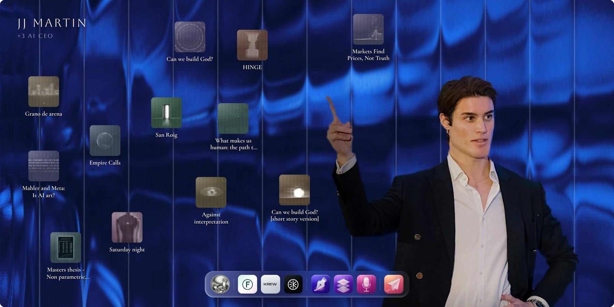
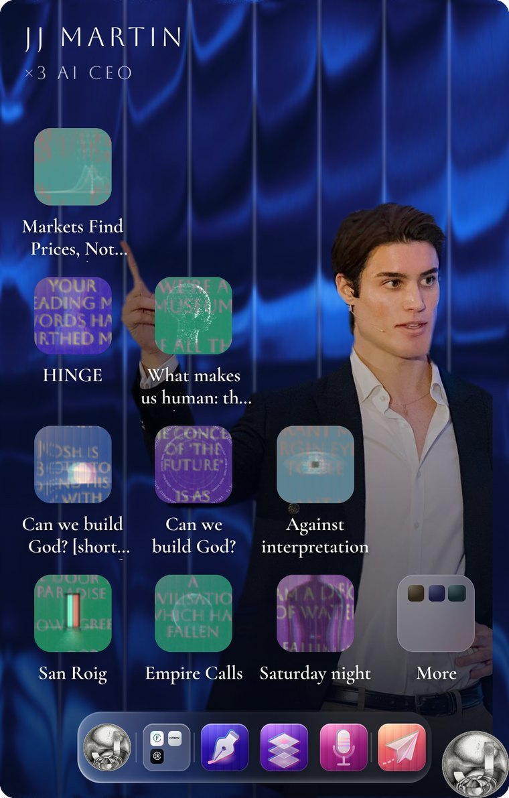
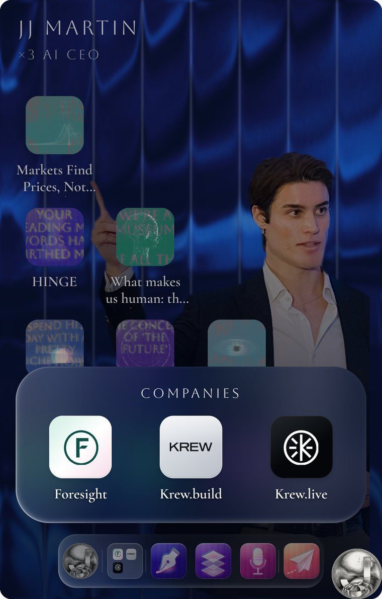
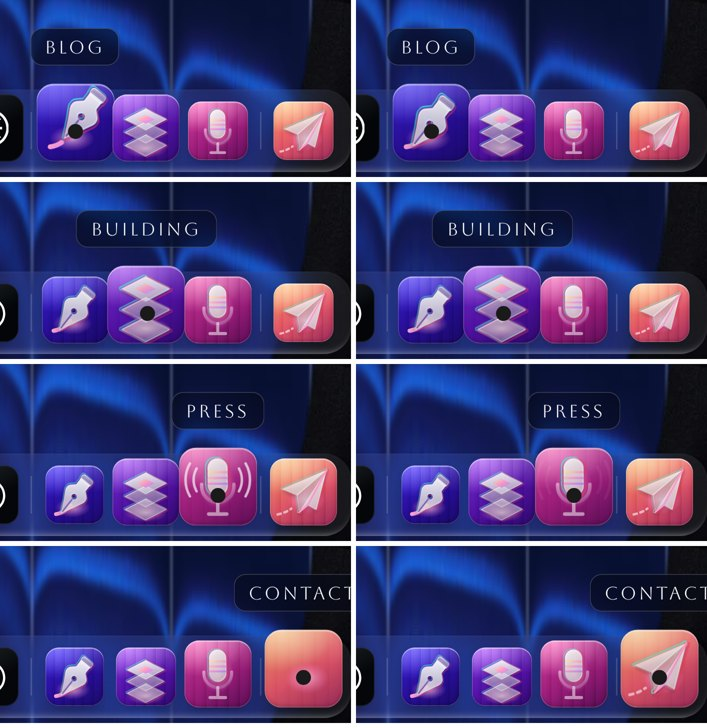
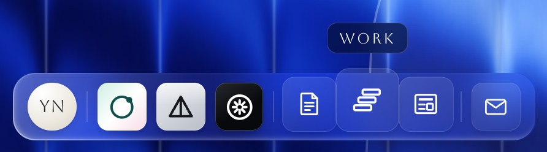

# itsmartinwho-hero-UI

A personal-desktop hero for React. Your name sits in the corner of a wallpaper read through fluted glass. A figure is cut out and stands on it. Your posts lie on it as files, each with its own live picture, and a dock holds your links. On a phone the same desktop becomes an iOS-style home screen, with the posts in a staircase, folders, and a full-width dock.



<p>
  
  
</p>



*These previews show the hero as it was designed, on [jjmartin.co](https://jjmartin.co). The portrait, writing and company marks in them belong to that site. They are not in this repository and the license doesn't cover them. The demo ships with neutral placeholders:*


## What's in it

- **A wallpaper under glass.** Any picture, read through [Paper Design](https://shaders.paper.design)'s fluted-glass shader. The glass fades in once the page is idle. Without WebGL the picture stays as it is.
- **A cut-out figure.** A sharp photograph is masked by a feathered trace of its silhouette and stands on the card's bottom edge. The glass never touches it. `scripts/build-figure.mjs` makes the two files from a photo and an SVG trace. An already cut-out PNG works too.
- **Posts as files.** Each icon is a live picture: the post's lines set in capitals and refracted through fluted glass on a 2D canvas, with an optional SVG overlay on top. They're asleep until needed: one frame is drawn, then held. A slow spotlight wakes one at a time. Hovering or focusing an icon brings its lines into focus and washes it in colour. Touch screens have no hover, so there the icons rest in that engaged look. You can use a picture or any element instead of the live icon.
- **A dock.** Groups of links on frosted glass, with magnification and names on hover. It comes with two styles of built-in glyph. The liquid-glass ones (a nib, layers, a microphone and a paper plane) each sit on their own colour ground and do one small thing on hover. The quieter line ones (a page, steps, a newspaper and an envelope) sit on faint glass. A tile can also hold a picture or your own mark.
- **A phone layout.**
  - **Staircase:** the posts stand four, three, two and one high on the left, so the figure keeps the top and the right. Posts that don't fit go in a "More" folder.
  - **Folders:** any dock group can become a folder that opens the iOS way.
  - **Short screens:** the icons shrink so the top step never reaches the name.
- **Built to stay light.** It uses one WebGL context, for the glass. Icons draw on 2D canvases, at 30 fps at rest, and only near the screen. Nothing runs while the hero is off screen or the tab is hidden. Hover easing respects `prefers-reduced-motion`.

## Run the demo

```bash
npm install
npm run dev
```

Then open http://localhost:3000. The demo is a Next.js app: `app/page.tsx` renders the hero, and `app/demo.tsx` holds the sample posts and dock. `/line` shows the same hero with the dock in the line style.

## Use it in your project

The component is plain React 19 with one dependency, and needs a bundler that handles CSS Modules (Next.js and Vite both do). Copy `src/hero/` into your project and install the shader package:

```bash
npm install @paper-design/shaders-react
```

```tsx
import { Hero, FINISHES, PALETTES } from "./hero";

<Hero
  name="Your Name"
  tagline="Founder · Writer"
  wallpaper="/wallpaper.webp"
  figure={{ src: "/hero/figure.webp", mask: "/hero/figure-mask.png" }}
  posts={[
    {
      id: "on-slowness",
      title: "On Slowness",
      href: "/blog/on-slowness",
      lines: ["The fastest way through a hard problem", "is to stop running at it"],
      palette: PALETTES.indigo,
    },
    // …up to twelve on a desktop; on a phone, nine and a folder for the rest
  ]}
  dock={[
    { items: [{ label: "About", href: "/about", icon: { image: "/me-coin.png", round: true } }] },
    {
      folder: "Projects", // one folder on a phone
      items: [
        { label: "Orbit", href: "https://orbit.example", external: true, icon: { node: <OrbitMark />, ...FINISHES.pastel } },
        { label: "Prism", href: "https://prism.example", external: true, icon: { node: <PrismMark />, ...FINISHES.silver } },
      ],
    },
    {
      items: [
        { label: "Blog", href: "/blog", icon: { glyph: "nib" } },
        { label: "Work", href: "/work", icon: { glyph: "layers" } },
        { label: "Talks", href: "/talks", icon: { glyph: "mic" } },
      ],
    },
    { items: [{ label: "Contact", href: "/contact", icon: { glyph: "plane" } }] },
  ]}
/>
```

**Next.js:** pass `linkComponent={Link}` so internal links use client-side navigation. Do it from a client component (see `app/DemoHero.tsx`), because a server component can't pass a function to a client one. The files carry `"use client"`, so they work in the App Router as they are.

**Fonts:** the hero reads two custom properties. `--hero-caps` is the capitals face (the demo uses [Aboreto](https://fonts.google.com/specimen/Aboreto)). `--hero-serif` is the captions' face (the demo uses [Cormorant Garamond](https://fonts.google.com/specimen/Cormorant+Garamond), weight 600). See `app/layout.tsx`.

## Props

| Prop | Type | |
|---|---|---|
| `name` | `string` | The name in the top left (an `h1`). |
| `tagline` | `string?` | The line under it. |
| `wallpaper` | `string` | The picture the glass bends, at least 1400px wide. It's covered into a 2:1 card on a desktop and a 10:16 one on a phone. |
| `figure` | `HeroFigure?` | `{ src, mask?, wide?, mid?, phone? }`. Each band takes a `FigureFit`: `anchor` (object-position), `scale` and `x`. |
| `posts` | `HeroPost[]` | `{ id, title, href, lines?, palette?, phase?, overlay?, image?, icon? }` |
| `dock` | `DockGroup[]` | `{ items: DockItem[], folder? }`. A `DockItem` is `{ label, href, external?, icon }`. |
| `glass` | `Partial<GlassTune>?` | The shader's size, distortion, blur, shadows, highlights, edges and colours. |
| `linkComponent` | `ElementType?` | Renders internal links. Defaults to `<a>`. |
| `label`, `className`, `style` | | The section's accessible name (defaults to `name`) and styling. |

**Dock icons** (`DockIcon`):

- `{ glyph: "nib" | "layers" | "mic" | "plane", ground?: "ultramarine" | "violet" | "magenta" | "coral" }`. Glyph tiles take the grounds in turn if you don't name one.
- `{ line: "page" | "steps" | "news" | "mail", color? }`. The quiet style: a 1.5-stroke line glyph in white (or `color`) on a squircle of barely-there glass.
- `{ image, round? }`
- `{ node, background?, color?, round? }`. Your own SVG or letters. `FINISHES` has `pastel`, `silver`, `ink` and `bone`.

You can mix both glyph styles in one dock. To see the line style, run the demo and open `/line`:



**Post icons:** posts with no `palette` take one from `PALETTES` in turn. `overlay` is drawn on the icon's glass, a 16:10 picture cropped to a square, so keep what matters in the middle. `image` or `icon` replace the live picture.

**Placement:** the desktop scatter (`WIDE`, `MID`), the phone staircase (`PHONE_SLOTS`) and the spotlight's order live in `src/hero/placement.ts`. They're plain data you can edit. The scatter keeps to the left three-fifths of the card and leaves the right for the figure.

## Your figure

1. Pick a photograph with you standing to the right and clear space to your left.
2. Trace your silhouette as one filled SVG path in the photo's own pixel space (`viewBox="0 0 <width> <height>"`). Use any vector editor, zoomed in on the hair and hands. Put gaps (between an arm and your side) in as further subpaths, with `fill-rule="evenodd"`.
3. Build the figure and its mask:

   ```bash
   npm run figure -- --photo me.jpg --silhouette me.svg --out public/hero
   ```

   This writes `figure.webp`, the photo with the background flattened, and `figure-mask.png`, the silhouette pulled in a pixel and feathered so there's no halo or cut line.
4. Pass `figure={{ src: "/hero/figure.webp", mask: "/hero/figure-mask.png" }}`. Then move it with `wide`, `mid` and `phone` until it stands where you want.

A cut-out PNG (transparent background) works too: pass it as `src` with no `mask`.

## Wallpaper

`public/demo/wallpaper.webp` is generated, not photographed, so you're free to use it. Make another with a different seed or colour:

```bash
npm run wallpaper -- public/wallpaper.webp --seed 12 --hue violet   # blue | violet | teal | ember
```

Any photograph works too: silk, water and folded paper read especially well through the glass. Tune the glass with the `glass` prop.

## Theming

Set these as custom properties on the hero or any ancestor:

| Property | Default | |
|---|---|---|
| `--hero-caps` | `system-ui` | The capitals face. |
| `--hero-serif` | `Georgia` | The captions' face. |
| `--hero-bg` | `#050a1a` | The colour behind everything while it loads. |
| `--hero-top` | `0px` | The space above the hero on a phone (a nav bar), so the card fits the screen. |
| `--dock-inset` | `6px` | A phone dock's distance from each side. Raise it to clear a floating button in a corner. |

## Browser support

Current Chrome, Edge, Safari (16+) and Firefox. It needs CSS container queries, `backdrop-filter` and, for the glass, WebGL 2. Without WebGL the wallpaper shows unglassed, and everything else works.

## Credits

- The fluted glass is [Paper Design's shaders](https://github.com/paper-design/shaders) (Apache-2.0). The icons port its "contour" flute to a 2D canvas.
- Designed and built for [jjmartin.co](https://jjmartin.co) by José Martín Quesada ([@itsmartinwho](https://github.com/itsmartinwho)).

## License

[MIT](LICENSE): the code, the glyphs, the placeholder figure and the generated wallpaper. The preview screenshots are of jjmartin.co. The portrait, writing and company marks in them are not covered by the license.
