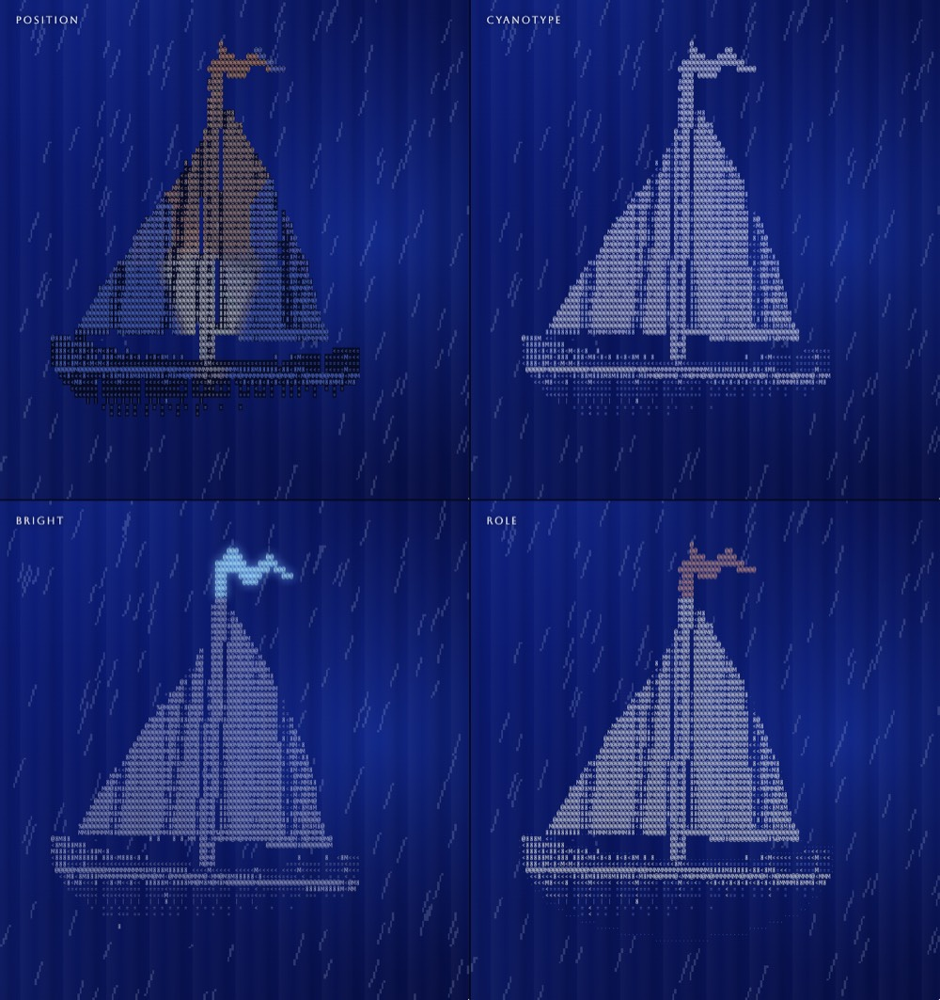
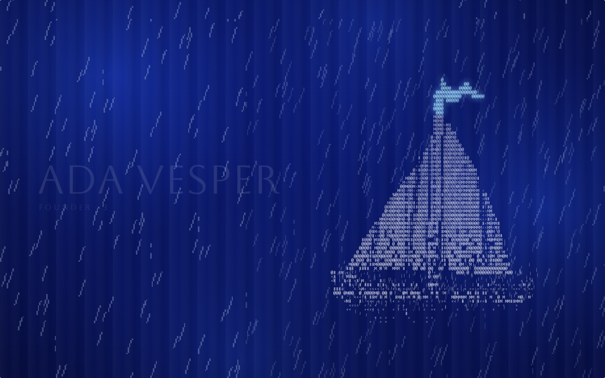
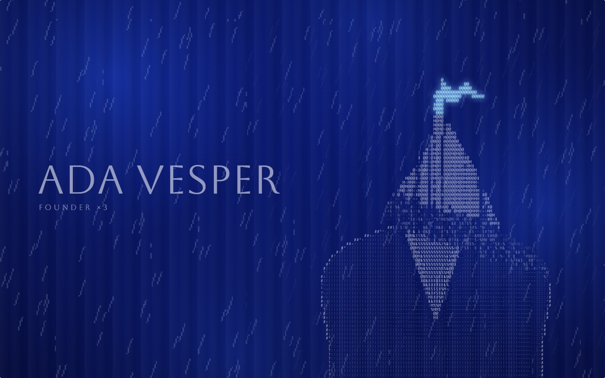

# Figure to sprite

A picture turns to type, the type turns to a 1-bit sprite, and the sprite plays on in the rain. One module, `transitions.js`, with three ways across and four palettes.

Open `index.html` through any static server. From the repo root:

```
python3 -m http.server
# then http://localhost:8000/figure-to-sprite/
```

The demo runs on stand-ins made in code: a lit 3D bust for the picture and a sailboat for the sprite, 12 frames on a 256 by 256 grid. Nothing is downloaded. Swap `placeholders.js` for your own picture and film.

## How it moves

One loop of 12 seconds:

| u | What happens |
| --- | --- |
| 0.00 to 0.10 | The picture and a name. The rain comes on. |
| 0.10 to 0.28 | A sweep slanted with the rain turns the picture to type. Each cell takes a glyph from the ramp `·.,:-~^=+*<>/\|?%#&$@8BMW`, set in Aboreto, for the picture's brightness there. Glyphs flicker in the band of the sweep and a few step to a neighbour now and then after it. |
| 0.28 to 0.42 | It holds as type. |
| 0.42 to 0.72 | The transition. |
| 0.72 to 1.00 | The sprite holds, animating at 24 frames a second. At the seam it gives way to the picture, so the loop closes. |

Rain falls from the first frame to the last, in front, faint. It is made of the film's own rain: the lit pixels that are not the sprite's.

## Transitions

- **Erosion.** The original. Cells turn from a point on the figure outward, with noise, into the sprite's own square pixels. Two textures at two sizes fight halfway, and the sprite is bigger than the figure, so the scale jumps.
- **Rain.** The type falls with the rain, column by column. A beat of rain alone, then the sprite condenses out of the falling drops.
- **Retype.** The reference, and the one jjmartin.co kept. One glyph grid. A sweep at the rain's slant re-types each cell, like a departure board, until the grid holds the sprite. It reads at any scroll speed because it is one texture throughout.

## Palettes

- **Position.** Each cell takes the colour of the picture under it, lifted. This was the original. It puts colours in the wrong places on any other shape: here the bust's skin lands on a pennant and its jacket on a sail. It also sets the type on a dark plate that turns the figure into a dark patch on the backdrop.
- **Cyanotype.** One blue ramp, from deep blue to ice white, for figure and sprite alike.
- **Bright.** White at three strengths, and the sprite's one thin accent part, here the pennant, alone in pale teal with a soft glow.
- **Role.** The picture's own colours, placed by part: light fill, mid, outline, and the accent.



## Screenshots

| Erosion | Rain | Retype |
| --- | --- | --- |
|  |  |  |

Erosion is shown with Position, Rain and Retype with Bright.

## Use it

The demo mounts the sketch with `../shared/runtime.js`:

```html
<div class="stage" data-sketch="./transitions.js#transitions"></div>
<div class="seg" data-setting="transition">
  <button type="button" data-value="erosion">Erosion</button>
  <button type="button" data-value="rain" aria-pressed="true">Rain</button>
  <button type="button" data-value="retype">Retype</button>
</div>
<div class="seg" data-setting="palette">
  <button type="button" data-value="position">Position</button>
  <button type="button" data-value="cyanotype">Cyanotype</button>
  <button type="button" data-value="bright" aria-pressed="true">Bright</button>
  <button type="button" data-value="role">Role</button>
</div>
<script type="module" src="../shared/runtime.js"></script>
```

The sketch reads two settings on every frame:

| Setting | Values | Default |
| --- | --- | --- |
| `env.settings.transition` | `erosion`, `rain`, `retype` | `rain` |
| `env.settings.palette` | `position`, `cyanotype`, `bright`, `role` | `bright` |

`env.canvas("2d")` gives it a canvas filling the stage; the sketch returns `{ mode: "loop", duration: 12, still, render(u, time) }`. To use it without the runtime, build an `env` with `canvas()` and a `settings` object, and call `render` from your own `requestAnimationFrame`.

The tunable numbers are constants at the top of `transitions.js`: the glyph ramp (`RAMP`), the rain's strength (`RAIN_A`), the sweep's slant and band (`SLANT`, `BAND`), the film's frame rate (`FPS`), the cyanotype ramp (`CYAN`), the accent colour (`TEAL`). The sprite's square is 0.95 of the stage's height, placed so that 0.52 across it lands on the figure's chest.

## Swap the picture and the film

The sketch reads nothing but `placeholders.js`. It exports:

- `picture(w, h, dpr)` returns `{ silk, figure, layout }`. `silk` is the backdrop and `figure` the figure with alpha, both canvases of `w x h` CSS pixels times `dpr`. `layout` is in CSS pixels: `figure` is its rectangle, `chest` where the sprite is centred and the transitions start, `top` where the sweep begins, just above the head.
- `drawName(ctx, w, h, alpha)` sets a name where a hero would.
- `sprite()` returns `{ G, R }`, two `Uint8Array`s of 12 x 256 x 256 entries, 0 or 1, one per pixel. `G` is the sprite's own pixels. `R` is every lit pixel: the sprite's lit ones are lit and own, and the rain is lit and not own. The left 34 columns of every frame must be rain and nothing else: the transitions tile them to rain across the stage. The sprite should stand with its middle about 0.52 across the frame, so it lands on the chest.
- `accentAt(x, y)` says which pixels of the sprite are its one accent part. Keep it a thin shape, a few cells across. It is the pennant here, and the `bright` palette's pale teal.
- `PALETTE` is `{ accent, outline, light, mid }`, the picture's own colours as RGB, for the `role` palette.

## Where it came from

The type is ASCII art's own: a ramp of marks ordered by the ink each carries. Retype is a split-flap departure board. The sprite is in the manner of a 1-bit GIF, and the rain is made in code.

MIT licence, see `../LICENSE`.
