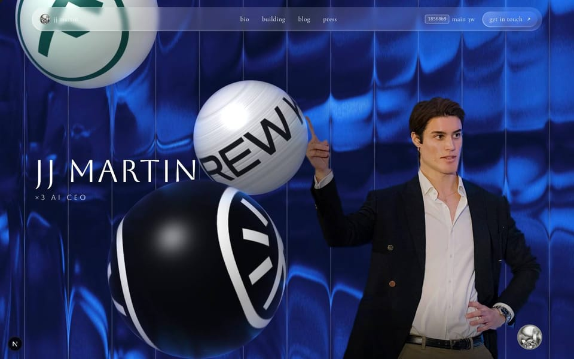
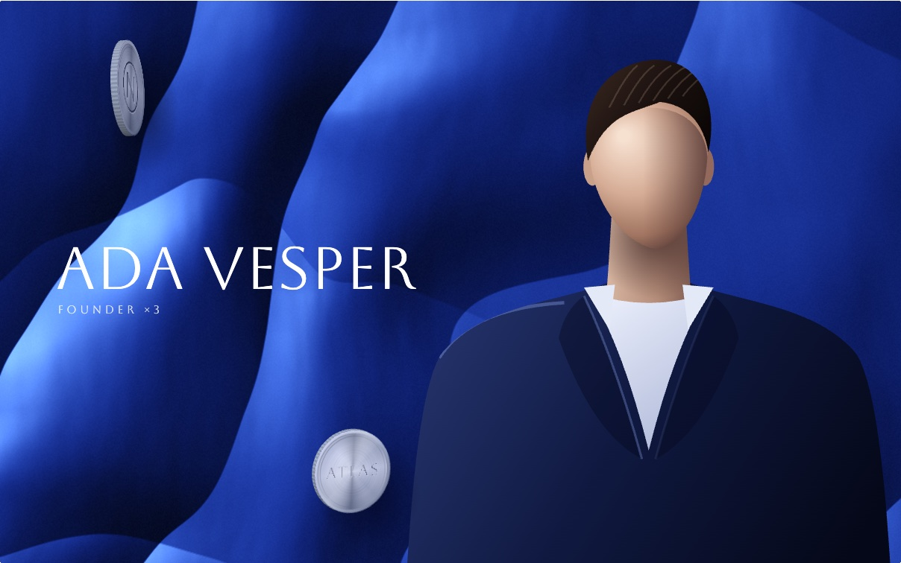
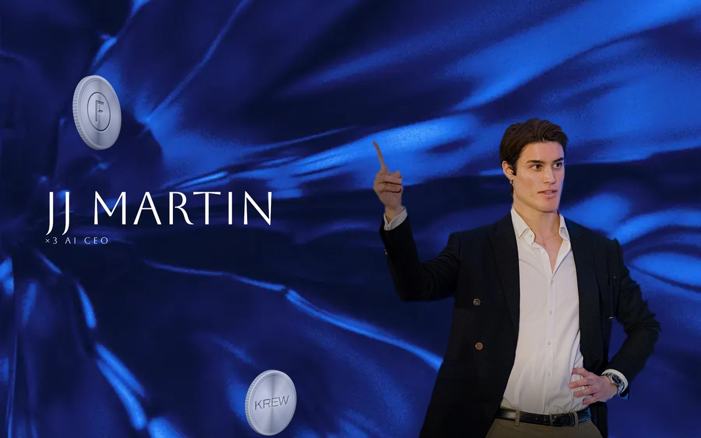
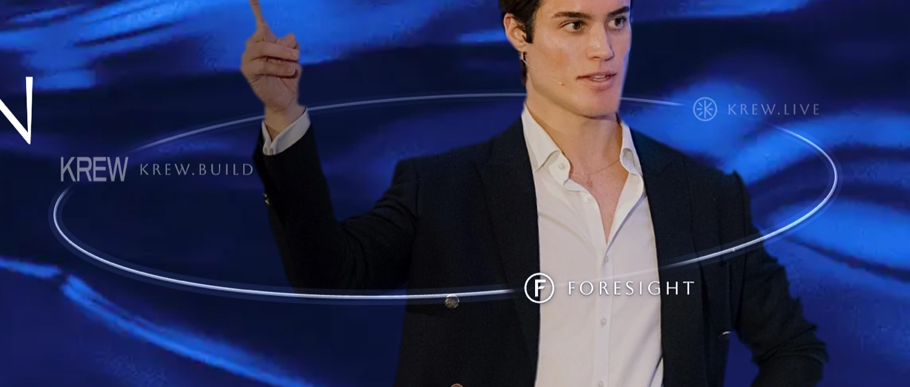
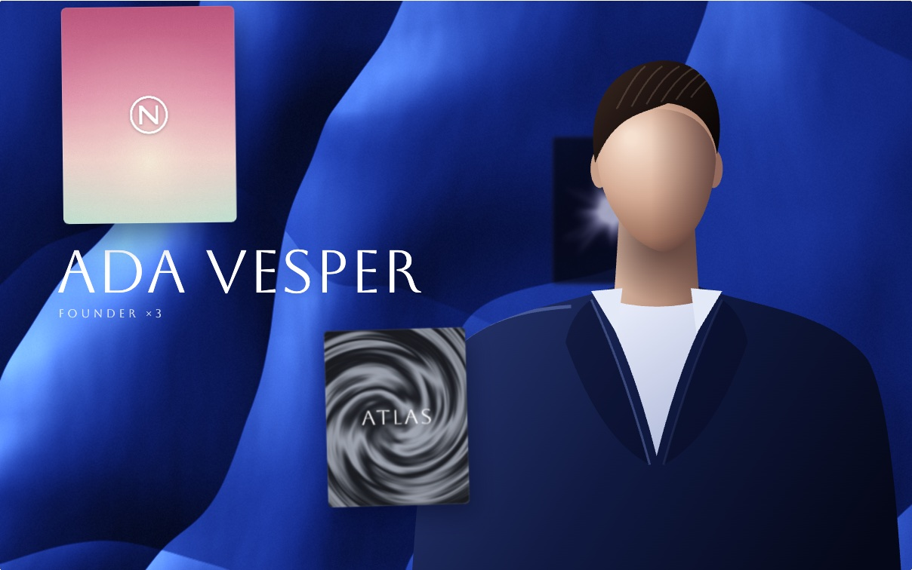
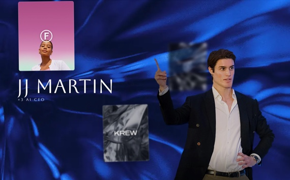
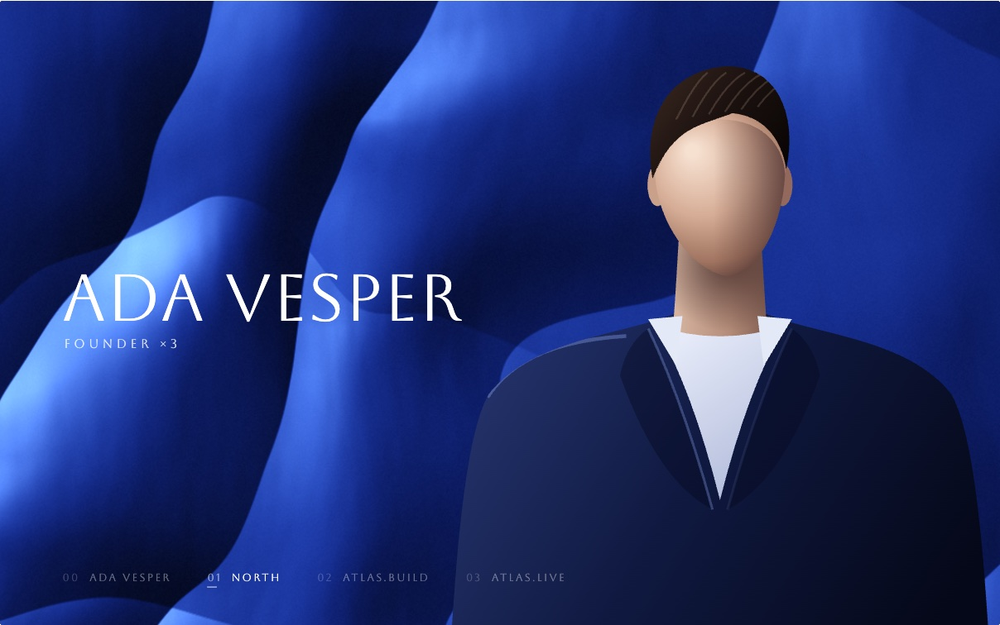
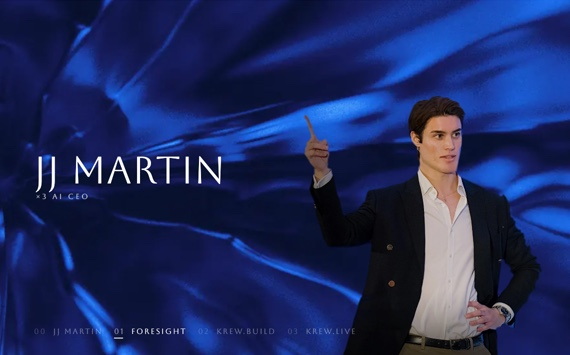

# Floating marks

A few marks cross a hero picture while a figure stands in it. Five pieces, from a WebGL sphere to a quiet index. Each is one ES module with no dependencies.

Open `index.html` through any static server. From the repo root:

```
python3 -m http.server
# then http://localhost:8000/floating-marks/
```

The demo runs on stand-ins made in code (a satin backdrop, a bust, three invented marks), so nothing is downloaded. Swap `placeholders.js` for your own picture.

## The pieces

| File | What it is | How it moves |
| --- | --- | --- |
| `spheres.js` | One sphere a mark, ray-cast in WebGL2. Each wears its mark on a finish: pale and pearly, brushed silver, black. | They rise through the picture on a slanted axis, turning. They are lit softly from the upper left, and the backdrop is bent into their rims. |
| `coins.js` | The marks minted as thin brushed-nickel medallions with a milled rim and an engraved face. Canvas 2D. | They rise turning on edge, so each reads as an object. A soft shadow falls down and to the right, and a glint sweeps the face as it turns. |
| `orbit.js` | Three names riding one thin tilted ring. Canvas 2D. | The ring passes behind the figure and in front of the chest. Names are bigger and brighter as they come round the front. |
| `deck.js` | Three plates, each a picture with its mark. Canvas 2D. | They rise at three depths. The far one is blurred and passes behind the figure. The near two are sharp and cast a shadow. |
| `index.js` | Nothing floats. A name, a figure, and an index at the foot. Canvas 2D. | One entry is lit at a time, a hairline drawing under it. The backdrop pushes in two percent and back, so slowly it only looks alive. |

All five are loops (`mode: "loop"`, 10 to 14 seconds). The scrubber under each stage moves the loop by hand. Under reduced motion they rest on one frame until you press play.

## Run a piece in your page

The demo mounts pieces with `../shared/runtime.js`:

```html
<div class="stage" data-sketch="./coins.js#coins"></div>
<script type="module" src="../shared/runtime.js"></script>
```

The runtime draws frames only while the stage is on screen and the tab is showing. It gives each piece an `env`:

- `env.canvas(type)` adds a canvas that fills the stage at the device's density (to 2) and returns `{ canvas, ctx, w, h, dpr }`. `w` and `h` are CSS pixels and stay current on resize.
- `env.reduced` is `prefers-reduced-motion`.

Each module exports `sketches = { name: async (env) => ({ mode, duration, still, render(u, time, dt) }) }`. `u` runs 0 to 1 over `duration` seconds. To use a piece without the runtime, build an `env` with a canvas and call `render` from your own `requestAnimationFrame`.

## Options

There is no options object. Each piece keeps its choices in a constant at the top of its file:

| Constant | In | What it sets |
| --- | --- | --- |
| `SPHERES` | `spheres.js` | Per sphere: skin, radius (share of the shorter side), column, the span of the loop it takes to rise, spin axis, turns, where the turn starts. A `portrait` set is used on tall stages. |
| `COIN` | `coins.js` | Per coin: diameter, column, start in the loop, turns, the angle it passes the middle at, lean, sway. |
| `ORBIT` | `orbit.js` | The ring's centre (shares of width and height), radii, roll, perspective. |
| `PLATE` | `deck.js` | Per plate: which picture and mark, height, column, start, length, lean at start and end, sway, blur, alpha, shadow, scrim. Order is far, mid, near. |
| `ITEMS` | `index.js` | The index: a number and a name per entry. Each gets the same share of the loop. |

`duration` and `still` are in the object each factory returns, at the bottom of its file.

## Swap the picture

The pieces read nothing but `placeholders.js`. It exports:

- `hero(w, h, dpr)` returns `{ backdrop, figure }`, two canvases of `w x h` CSS pixels times `dpr`. The figure has alpha and stands on the bottom edge at the right. Pieces draw the backdrop, then whatever passes behind the figure, then the figure.
- `drawName(ctx, w, h, alpha)` sets a name in the open space to the left of the figure.
- `MARKS` is a list of `{ name, ar, wide, draw(ctx, x, y, w, h) }`. `draw` fills the mark with the current `fillStyle`. `ar` is width over height and `wide` marks a wordmark.
- `markImage(mark, long, color)` paints a mark onto its own canvas.
- `skins()` returns three 1024 by 512 longitude-latitude maps for the spheres, with the mark twice round the equator. Same order as `MARKS`.
- `plates()` returns three 4:5 pictures for the deck. Same order as `MARKS`.

`orbit.js` places its ring with the `ORBIT` numbers, which are tuned to the stand-in bust. Move them to fit your figure.

## Screenshots

Each piece, running on the stand-ins, and again as used on jjmartin.co.

| | Demo | On jjmartin.co |
| --- | --- | --- |
| Spheres |  |  |
| Coins |  |  |
| Orbit |  |  |
| Deck |  |  |
| Index |  |  |

## Where it came from

- Spheres: the floating balls of 100k.studio.
- Coins: the engraved corner coin on jjmartin.co.
- Orbit: the Orbit tile of Bureau Cool.
- Deck: the stacked records of Unveil.
- Index: Unveil's filter bar, which does the same job for a page of work.

MIT licence, see `../LICENSE`.
